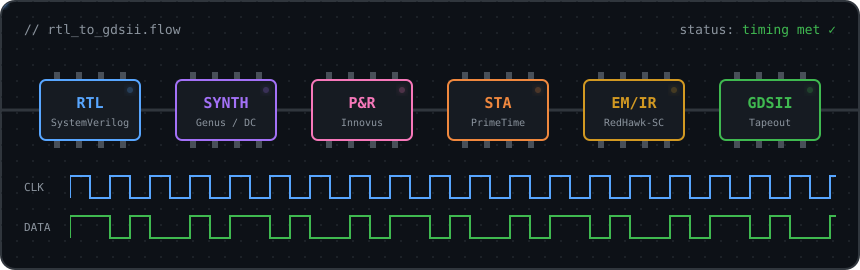

<h1 align="center">Hey there 👋, I'm Manas Kulkarni</h1>
<h3 align="center">GPU Physical Design Engineer @ Intel · UPenn MSE in Electrical Engineering</h3>

  
  
  

---

### 🧑‍💻 About Me

I work at the intersection of **silicon design and automation**, from RTL to GDSII, signoff methodology, and AI-driven EDA workflows.

- 🏢 **GPU Physical Design Engineer at Intel** (Folsom, CA), in the Graphics HW IP Tools, Flows & Methodology team
- ⚙️ Building **signoff methodology automation** for STA and EM/IR across **TSMC N2/N3** using PrimeTime and RedHawk-SC
- 🤖 Developing **agentic workflows for reliability and power optimization** in physical design signoff
- 🔬 Master's thesis at the **UPenn Architecture and Compilers Group**: taped out a low-power pipelined **RV32I RISC-V** processor in TSMC 45nm
- 🎓 **MSE, Electrical Engineering, University of Pennsylvania** · **BTech, Electronics Engineering, K. J. Somaiya College of Engineering**
- 💬 Ask me about **Physical Design, Signoff (STA / EM-IR), RISC-V, Mixed-Signal ASICs, Embedded Systems, and AI for EDA**

---

### 💼 Experience

**🔷 Intel** · GPU Physical Design Engineer · *Jun 2025 – Present*
- Automating STA and EM/IR signoff flows for GPU designs on TSMC N2/N3 with PrimeTime and RedHawk-SC, using Python and TCL
- Debugging timing and EM/IR issues, benchmarking new tool releases, and working with design owners to get blocks ready for tapeout

**🛢️ SLB** · Electrical Engineer Intern, New Product Development · *Jun – Aug 2024*
- Prototyped 175°C-rated Hall-sensor and LVDS safety hardware for a neutron detector data acquisition system in KiCad
- Wrote a low-level Octal SPI memory driver for an XMC7200 MCU and an Intel Cyclone 10 LP FPGA sharing a dual-ported SRAM

**🎓 UPenn Architecture and Compilers Group** · Research Assistant (Master's Thesis) · *Aug 2024 – Jun 2025*
- Led the tapeout of a low-power pipelined RV32I RISC-V processor in TSMC 45nm, from SystemVerilog RTL to GDSII using mflowgen
- Ran synthesis, place & route, STA, timing closure, and power analysis with Genus, Innovus, Tempus, and Voltus

**🏎️ Team Orion Racing India** · Head of Embedded Systems & Controls · *Feb 2021 – Jul 2023*
- Led ECU and vehicle-control development on NI myRIO (LabVIEW FPGA) for a Formula Student electric race car
- Built the CAN-based telemetry and DAQ stack, streaming over MQTT to InfluxDB/Grafana on GCP, plus the car's safety circuits and power distribution

---

### 📄 Publications

- **Spice Wizard: A Unified AI Agent for Netlist Generation**, *IEEE TechRxiv, Feb 2026*
  `LLM Agents` `Fine-tuning` `SPICE` `ML for EDA`
- **A Survey on Beagle Boards and its Applications**, N. Mehendale, M. Kulkarni, O. Bhoite, *TechRxiv, Dec 2022*

---

### 🛠️ Languages & Tools

**Languages & Scripting**

  

**EDA: Physical Design & Signoff**

**FPGA, PCB & Simulation**

**Microcontrollers & Boards**

**Protocols**

`AXI` `AHB` `APB` `PCIe` `Ethernet` `USB` `CAN` `UART` `SPI` `I2C` `RS-232` `RS-485` `MQTT` `BLE` `ZigBee`

---

### ⚡ Signal Flow

  

---

<i>"From RTL to GDSII, and teaching the tools to think along the way."</i> ⚙️

